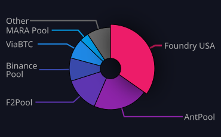

# Hi there 👋, I'm Pamela (Pjrich1313)

## About Me
- Passionate about technology, data, and blockchain.
- Interested in AI agents, crypto, and open-source collaboration.
- Building personal blockchain/crypto projects, smart contracts, and brand assets (Sealpath, Chance Lab, etc.).

## Audit & Protection
This profile and associated repositories are under active audit for landmarks, structure, timestamps, and integrity.

- See [PROTECTED.md](PROTECTED.md) for protection rules and authorized access.
- See [agents.md](agents.md) for the AI coding agent.
- Workflows: Audit and Closure, SLSA Provenance.

**Status:** Audit initiated. Original work is solid and preserved. No unauthorized alterations or external access.

## My Graphs & Analytics

### Block Rewards (3M)

### Pools Ranking (1W)

## Connect With Me
- GitHub: [@Pjrich1313](https://github.com/Pjrich1313)
- Email: pamelacarr1313@icloud.com
- Location: Osceola, Iowa

---

*This is my GitHub profile README. Published and under audit as of November 6, 2026.*

## License

Licensed under either of the Apache License, Version 2.0 (LICENSE-APACHE) or the MIT license (LICENSE-MIT), at your option. Copyright (c) 2026 Pamela Richardson.
